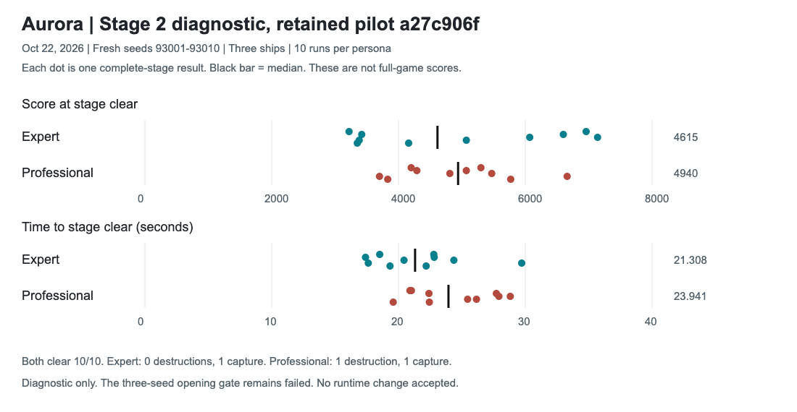

# Stage 2 Gate Review: October 22

## Decision

Gate remains FAILED. No runtime change accepted. No commit, push, or publication.
Work ran from 12:52:45 to approximately 13:17 UTC, within the 30-minute limit.
This packet supersedes the
next-action recommendation in STAGE2-ASSESSMENT.md, not its measurements.
Retained controller SHA256:
`a27c906faec56611e3295e3cc06edff59d869de70c8cf4c5cb6f6c709c0e6dfd`.
Source HEAD remains `bacb0c585f0ff516d2a3373cb16c563de5079ad3` with existing local work.

## Work Completed

45 browser gameplay runs: four attack-trace/control runs, six targeting-trial
runs, twenty fresh retained complete-stage runs, six official gate runs, two
collision-trace/control runs, six lookahead-trial gate runs, and one targeted
lookahead diagnostic. Two read-only specialists reviewed RNG, collision, and
gate interpretation. No independent editing or integration occurred.

### Attack Comparison

Seed 51201 instrumentation preserved all selected combat events: Expert 153,
Professional 132. First random-draw timing difference is ordinal 204:
Expert 0.533s versus Professional 0.600s. First caller difference is ordinal
210: Expert fire roll at 1.800s versus Professional formation-shot velocity
at 1.933s. Both use the same underlying RNG stream.

Therefore shared seeds do not provide identical attack opportunities. The
missing 800-point boss kill is not proof of an equivalent missed shot. This
does not waive the existing deterministic regression contract.

Across 150 frames from 3.5-6s, movement/firing target pools select different
targets on 18 Expert frames and 29 Professional frames. Independent rescoring
with post-movement positions confirms these counts. At 3.850s Professional
steers toward a formation boss while firing selects a bee. Alignment is a
coherent hypothesis, but the tested change failed acceptance.

### Rejected Trials

Values below are Professional score / kills / destructions at 16 seconds.

| Seed | Expert | Retained | Aligned targets | Lookahead only |
| --- | --- | --- | --- | --- |
| 51101 | 2930 / 34 / 1 | 2930 / 36 / 0 | 5290 / 30 / 0 | 2970 / 35 / 0 |
| 51201 | 4250 / 38 / 0 | 2820 / 33 / 0 | 5450 / 33 / 0 | 3690 / 30 / 0 |
| 51301 | 5080 / 28 / 0 | 5850 / 33 / 0 | 4200 / 31 / 1 | 4240 / 32 / 0 |

Aligned-target source: `7e6372ea306d730f3158e93260233c68063396b6f7d35e0fa7fa1286ef188b62`.
Lookahead-only source: `0066176be07233942fdfa1729c80bc23bf047cb8df248477a9201ac8c82a811a`.
Both are isolated copies. Neither changed enemy rules, rewards, RNG implementation, or
gate thresholds. No matched 900-second or reserved fresh acceptance runs
followed the short-gate failures. No candidate is a keeper.
Changed pilot actions still change RNG consumption and resulting encounters.

### Fresh Complete-Stage Diagnosis

Retained source only; seeds 93001-93010; Stage 2 start; three ships; 90-second
simulation budget. Metrics stop before Stage 3 spawns. These seeds are now
diagnostic data, not an unused acceptance set.

| Metric | Expert | Professional |
| --- | ---: | ---: |
| Stages cleared | 10/10 | 10/10 |
| Median score at clear | 4615 | 4940 |
| Median clear time | 21.308s | 23.9415s |
| Destructions | 0 | 1 |
| Captures | 1 | 1 |

Professional scores higher on six seeds and clears faster on three. All runs
clear within budget. One Professional run kills 39 enemies because a collision
removes another enemy. Stage clearance alone does not prove safe shooting.
This small sample does not prove population superiority or failure rates.

This chart is separate from the 900-second versioned score-history chart.
Do not mix stage scores with full-game scores or call these released versions.

### Reproduced Safety Defect

Retained seed 93008 loses a ship at 12.467s to butterfly 711405630.
The last 31 decisions contain 28 direction reversals. Bullet avoidance and
body avoidance compete; the player repeatedly switches direction.

The trace reproduces 35/35 decisions and identical selected gameplay events.
All three final-frame endpoints collide. Offline recorded-hazard reachability
finds a left-left-left escape starting at 12.433s, two frames before impact.
This is a fixed-hazard diagnostic, not a counterfactual full simulation or
proof of human feasibility. It does establish that final-tick avoidance is
too late in this recorded encounter.

Enabling the existing lookahead resolver for all of normal Stage 2 prevents
destruction through 16s on this seed (3950 points versus 3900 retained), but
fails the unchanged gate elsewhere. It is rejected, not a safety keeper.
Complete-stage and full-game benefit for that candidate remain untested.

## Verification And Evidence

- Official Stage 2 throughput gate rerun: FAIL, seed 51201.
- New collision replay: 35 exact decisions PASS.
- Older Stage 2 replay: 31 exact decisions PASS.
- Older retained Stage 13 replay: 22 exact decisions PASS.
- Syntax checks for ten touched/generated JavaScript methods: PASS.
- Git diff whitespace check: PASS.
- Independent final report review: no blocking overclaim identified.
- Localhost8000: HTTP200, exact match to dist/dev and retained controller.
- Served HTML SHA256: `26700ead3aa357ebab6eaf3a245e262fd8e2b17467d855867a7f4b91d58f99ba`.
- No source build needed: gameplay source did not change in this cycle.

`timebox/provenance.json` records 209 archived inputs/results/methods with
SHA256 hashes and verified gzip recovery. Primary traces, raw sessions,
frozen HTML, candidate sources, and runtime snapshots are in
`private-artifacts/persistent/stage2-timebox-oct22/`. Off-machine backup is
not verified. Frozen HTML still needs existing assets for audiovisual replay.
Public summaries contain aggregate gameplay data; raw logs remain private.

## Next Action And Beta Path

1. Keep the accepted Professional policy and the failed gate. Do not repeat
   broad Stage 2 configuration sweeps or split RNG merely to force parity.
2. Use the new collision fixture to design arbitration specifically for
   competing body/bullet threats, with earlier escape commitment. First prove
   the policy on recorded, mirrored, and boundary cases. Then run the unchanged
   short gate; only a pass permits matched full-game and unused fresh tests.
   Player outcome: avoid left/right indecision without reducing shooting time
   throughout the stage. This is a proposed repair, not proven behavior.
3. Separately resolve the product contract if repeated bounded repairs still
   trade survival for the three-seed opening score. The current contract remains
   binding. Any replacement needs explicit approval and a frozen protocol before
   new evaluation. Complete-stage score, clear time, and survival must remain
   separately visible; a higher median cannot hide a new death.
4. Once persona acceptance is settled, finish live signed-in scoring for both
   games and real recovery/password-login acceptance using permitted browser
   access. Then review/checkpoint, run release freshness gates, obtain lane
   approval, verify hosted dev, and test/freeze the exact beta package.

No beta date is justified yet. This cycle adds diagnostic coverage, not an
accepted gameplay improvement or a closed release gate. Earlier Professional
full-game gains remain preserved.
