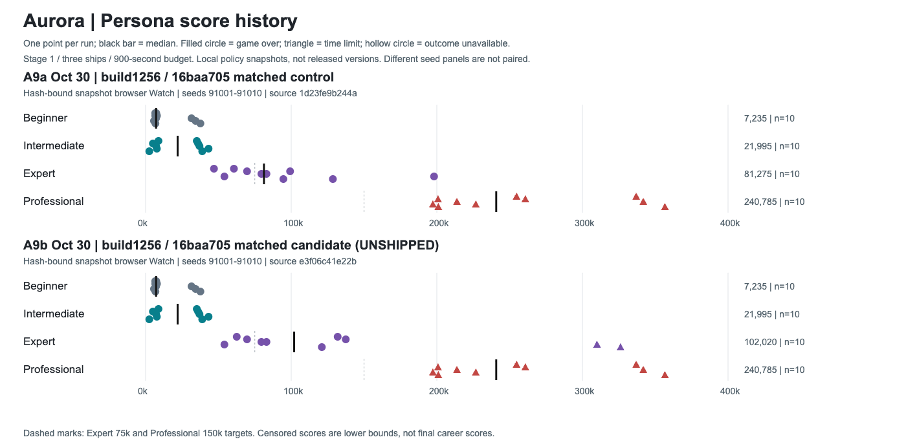
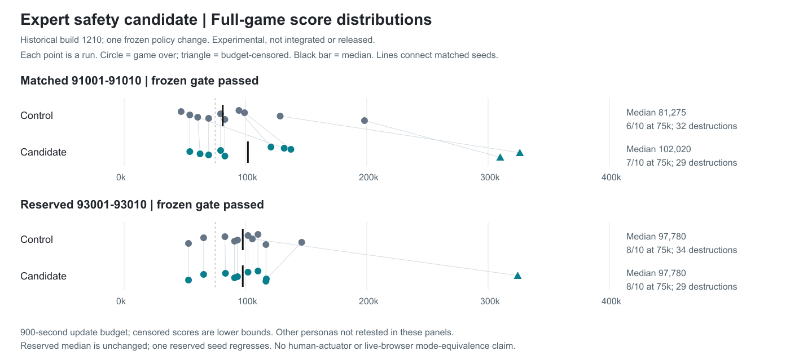
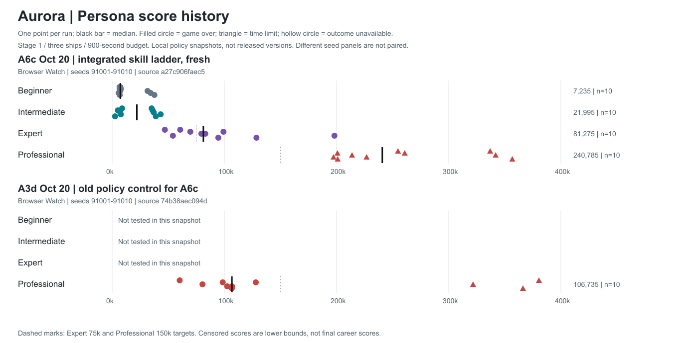
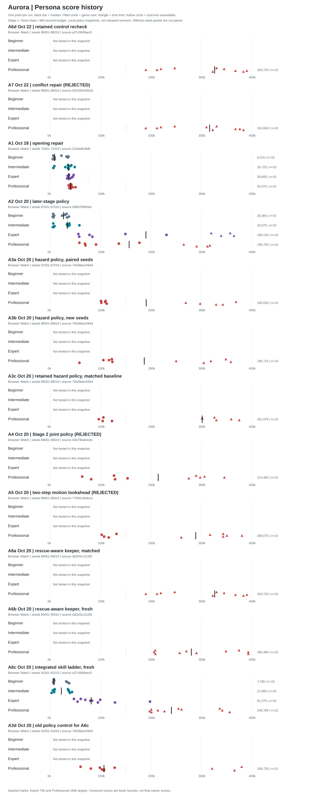
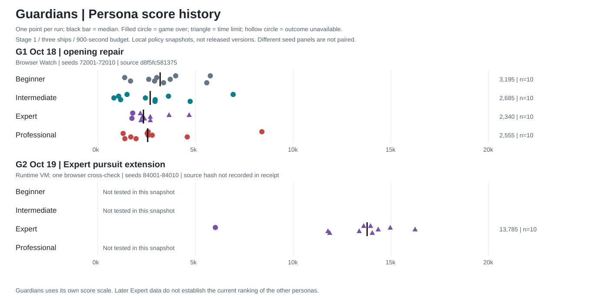
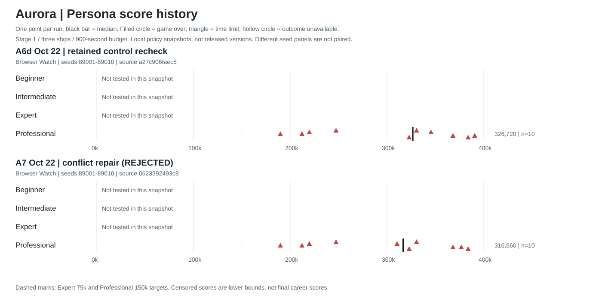

# Persona Score History And Process Review

Updated October 30, 2026. Includes retained policies and unshipped experiments.
No release was published by this cycle. All scores below are measured, not estimated.

## Current Result

The Expert body-veto experiment passes matched and reserved historical
and build1256 / `16baa705` snapshot nonregression gates, but is **not integrated or shipped**. Matched median
81,275 ->102,020 and75k attainment6/10 ->7/10; reserved median97,780 and8/10
attainment are unchanged. Destructions fall32 ->29 and34 ->29. One reserved
seed regresses. Snapshot build1256 / `16baa705` 100-run qualification passes; actual browser
P2 equivalence remains open. [Current report](../persona-calibration-oct30/CURRENT-BUILD.md).

The history contains23 panels and410 observations. A9a/A9b test all four
personas on matched build1256 / `16baa705` snapshot arms; A9c/A9d add reserved Expert arms.
Other-persona mechanics are unchanged. Professional median240,785 is a
900-second lower bound: all ten candidate observations are censored.
Earlier A6e/A8a and A6f/A8b
are paired controls/candidates on a historical bundle, not new release versions.
Other tiers were not retested in these panels. Three candidate observations are
budget-censored. Production1.4.2 is unchanged; next beta remains on hold.

## Historical October 20-22 Result

October22: Stage2-only trial rejected. No new900-second distribution was run;
this chart remains the accepted policy evidence, not an October22 retest.
See [Stage2 assessment](../persona-calibration-oct22/STAGE2-ASSESSMENT.md).

A6a/A6b/A6c contain30 distinct Professional runs: all reach150k,28reach200k,
all survive the900-second budget. A6a versus A3c and A6c versus A3d are matched
comparisons. A6c also measures all four tiers on the integrated source.
Expert median81275 meets the central score range but only6/10reach75k.
At that checkpoint, Professional consistency was a bounded local keeper while
Stage2 throughput and live-account acceptance were open. That is historical
release status, not the current beta checklist. The then-history had13panels/250runs.
See [keeper report](../persona-calibration-oct20/CAPTURE-RESCUE-KEEPER.md).

## Aurora

A1-A6 are local policy snapshot identifiers, NOT release version numbers.
A3a, A3b and A3c are the same source on different seed panels. A2 versus A3a
and A3c versus A4/A5 are matched-seed comparisons. Other panels show historical
distributions with different seeds, not controlled causal estimates.
No missing persona result is carried forward. No Wizard measurements exist.
Rejected16-second Stage2 trials are excluded: they do not share the900-second
full-game protocol and must not be mixed into these distributions.

The A3b Professional median186715 lies between two groups: five runs score
57910-123300 and five250130-358820. No run is near the median. Five of ten reach
150k, not the adopted eight-of-ten target. A larger median is not consistency.
Time-limited runs are right-censored: plotted scores are observed lower bounds,
not eventual final scores. Ten seeds are diagnostic, not a precise success-rate
estimate. A1->A2 Beginner changes may reflect seed variation, not a policy gain.

A4 is now REJECTED. On the same 89001-89010 seeds, retained A3c has median
301975 versus A4 214465, a 29.0% decrease. Six scores decrease and four rise.
Both reach150k in6/10 and have one early destruction. The short Stage2 gate
passes only for the rejected candidate; it does not establish full-game quality.

A5 preserves the rejected two-step observed-motion trial. Its median289075
is below matched A3c301975,despite minimum102170 and improved target89003.
Destruction totals fall10->3 but captures rise25->33; these are counts across
different survival durations,not rates. See ../persona-calibration-oct20/
LOOKAHEAD-TRIAL.md. Neither rejected trial changes the retained runtime.

## Guardians

Guardians has a different score scale. G2 is a runtime-VM panel with one browser
cross-check, not ten browser playthroughs. Its receipt lacks an exact controller
hash; that provenance gap is explicitly marked. Do not infer a current full
skill ladder from Expert-only evidence. No fabricated values fill missing tiers.

## Historical Process Findings

The capture/rescue repair above addresses the weak-tail mechanism. The findings
below explain the earlier failed trials and remain useful process lessons.

1. **The controller is coupled, but experiments were isolated parameters.**
   A small movement change alters firing columns, kills, bullet availability,
   target selection and subsequent encounters. Finding the first difference
   did not prove it caused the final scoring gap. Deadband7 improved one seed
   but exposed a collision on another. Narrow aim and both clearance trials
   also failed. None of these four recent trials delivered an accepted repair.
2. **Avoidance reasons are not decision traces.** `lower_field_evade` records
   a detected body even when bullet avoidance can choose the action. Missing
   complete bullet poses, alternative actions and winning branch prevent exact
   replay. We tested before measuring the safe alternatives at the failure.
3. **The early and later safety policies differ.** Early avoidance uses lanes
   and enemy-center crossing; later avoidance retains collision-box clearance.
   Opposing divers can alternate the selected threat. The later resolver checks
   a one-step endpoint, not swept moving-body collision. These are actual
   controller limitations, not reasons to weaken enemies or give extra lives.
4. **The Stage2 'safety' gate combines different requirements.** It requires
   no worse losses AND no lower score than Expert on each16-second seed. Zero
   losses with2820 versus4250 fails throughput, not safety. Per-seed short-window
   dominance does not itself define human Professional skill or full-game
   reliability. The gate remains unchanged; any contract change needs a
   documented product decision and replacement evidence, not a convenient waiver.
5. **We optimized visible summaries instead of the weak tail.** The retained
   later hazard policy improves matched median156705->190630 and minimum
   57810->100830, but150k attainment stays5/10. Current new-seed results are
   strongly split. Median alone concealed the work still required.
6. **The process encouraged repeated short loops.** The lead reused a broader
   later-stage filter before recognizing it also changed detection onset208->236.
   Review caught that confound. Criteria were not always frozen before a run;
   dirty snapshots shared build labels; latest summaries could omit outcomes.
   This is process debt we must fix, not more tuning work for the user to approve.
7. **Beta has independent blockers.** Live signed-in persistence is unverified;
   the skill ladder is incomplete; human/automated movement equivalence is not
   proved; final integration and exact-package checks remain. Persona tuning
   alone cannot make the release ready.

## Recommended Reset

1. Freeze the retained source and distribution history. No further parameter
   sweeps. Define separate safety, throughput, long-run reliability and control
   equivalence results while preserving existing pass/fail requirements.
2. Capture one complete opposing-hazard encounter: source/build/scenario hash,
   seed, tick, player/enemy/bullet poses and velocities, controller state, chosen
   branch and left/hold/right candidate scores. Preserve the primary replay.
3. Prove replay fidelity against the recorded action and collision. Add mirrored,
   boundary and fully-cleared-body cases using actual collision rules.
4. Test one joint alignment/safety policy with unchanged weapons, enemies and
   lives. Predeclare the acceptance criteria. Run the existing gate first, then
   a matched full-game panel and a reserved fresh panel if it passes.
5. Report lower-tail scores, deaths, completion/time-limit status and attainment
   alongside the median. Diagnose low-tail encounters rather than tuning to
   whichever seed failed most recently. Do not weaken Expert to create ordering.
6. In parallel, review scoring acceptance and release documentation read-only.
   Resume live score checks only with the permitted signed-in browser available.
   Maintain one runtime editor. No new gameplay experiment was run this turn.

## Maintain This Graphic

`node tools/harness/build-persona-score-history.js` validates source records,
rebuilds history.json, and renders both SVGs without private sessions or network.
PNG files are presentation copies; SVGs are the canonical documentation graphics.
To regenerate PNGs use a local Sharp installation, for each game:
`sharp(inputSvg).png().toFile(outputPng)`. The current PNGs were visually checked.

For every accepted persona-policy version and release candidate:
- Append a new immutable measurement packet and importer entry. Never overwrite
  earlier measurements. Retain rejected trials separately with explicit status.
- Record exact source/build/scenario/controller hashes, lane/version, mode,
  game, seed panel, starting stage/ships, time budget and measurement method.
- Store individual score/stage/outcome/simulation-time records. Require an
  explicit terminal status; unknown is visibly marked, never treated as gameover.
- Run all four personas on the same reserved panel for full-version comparisons.
  Partial runs remain explicitly missing, even if a persona's code is unchanged.
- Preserve raw evidence provenance. Rebuild this graphic and inspect it in the
  same work packet; link it from ACTIVE_WORK.md and the release assessment.

history.json contains410 observations across23 panels and hashes of its input
files. hazard-outcomes.json restores older terminal status from preserved raw packets,
checked against their recorded SHA256 and seed/score identity. Historical gaps
are disclosed; this backfill is not a claim of full coverage for every old build.

Related investigations: ../persona-calibration-oct20/STAGE2-DEADBAND.md,
STAGE2-COLLISION.md, HAZARD-ARBITRATION.md and REVIEW.md in that folder.
# October 22 Matched Safety Result

The new comparison adds20 full-game observations: retainedA6d and rejectedA7.
Professional median326720->316660 fails the frozen nonregression floor.
No runtime change was accepted. Other tiers were not tested in this packet.
The history now contains15 panels and270 observations.

